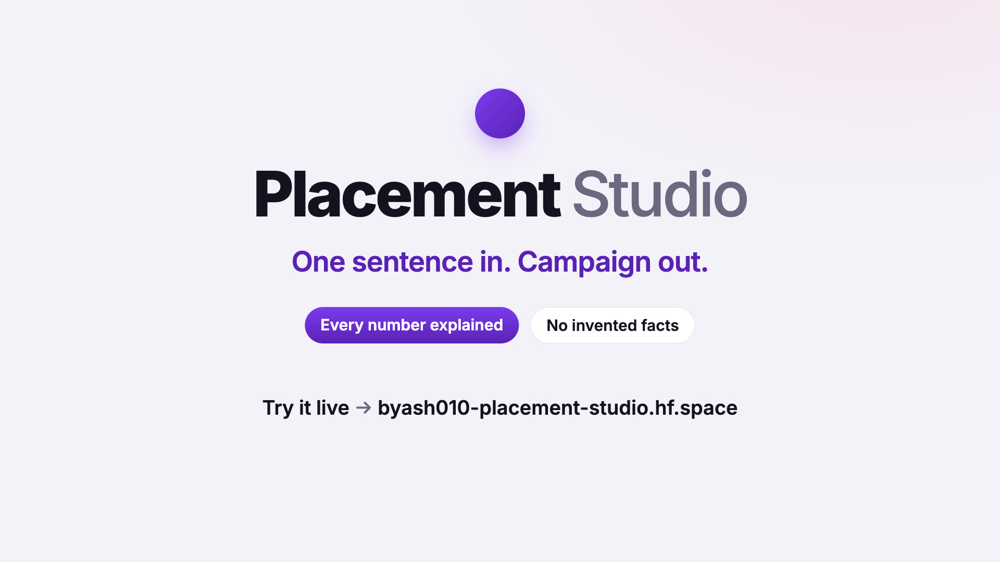

# Placement Studio

Type one or two sentences about a business. You get ranked publishers (with why the rest lost), one
ad per shopper persona, and a campaign config where every number is explained. Vague, B2B or empty
input gets an honest answer instead of a campaign.

**Live:** https://byash010-placement-studio.hf.space (cold start ≈1 min).

[](https://byash010-placement-studio.hf.space/demo.mp4)

```
cp .env.example .env          # add OPENAI_API_KEY
docker compose up --build     # API + UI: http://localhost:8000

uv sync; (cd web && npm install); make dev-api; make dev-web   # local dev, two terminals
uv run pytest -q; (cd web && npx vitest run)                   # tests
uv run python -m evals.run --stage1 --split all                # evals (evals/README.md)
```

## How it works

```
① Publishers   read the text (LLM) → gate → score publishers (code)   POST /api/campaign
② Personas     scored for the kept publishers (code)                  (same response)
③ Ads          Copywriter → code checks → Critic → one revision (LLM) POST /api/creatives
④ Config       budget, bids, caps, projection (code)                  POST /api/config
```

**Numbers from code, words from the LLM.** One LLM call reads the text into a brief, using only the
catalog's own category words. A gate picks proceed, clarify, out_of_scope or no_signal from that
brief (weak_fit is decided after matching). Publishers and personas are scored on 4 visible factors
each; personas include how well they fit the kept publishers.

**Ads.** One per persona, written in parallel. Code rejects numbers or claim words the advertiser
didn't write and over-long fields; the Critic reviews clean drafts; one revision fixes either. What's
still wrong ships flagged, never hidden. Repeated headlines are flagged too.

**Notes.** Each step has one note box ("skip Pawline", "make them playful", "under $5k"). On ①, ② and ④
one LLM call turns the note into fields code checks before applying; on ③ the note goes to the
writers. Each change, and anything the note asked that couldn't be applied, is listed.

**Stateless.** The browser sends step 1's result back with steps ③ and ④; the server re-checks ids,
words, ages and prices against the catalog. Paid calls are rate-limited per client and globally.

## Layout

```
app/
  api.py         routes, request checks, rate limits, errors → responses
  pipeline.py    step 1 end to end (and the full run the evals use)
  brief.py       read the text, gate, clarify questions, a step-1 note
  match.py       score publishers and personas
  ads.py         write and check the ads
  plan.py        the campaign config, a step-4 note
  rationale.py   one line per config field
  llm.py         OpenAI structured output, a disk cache, a fake for tests
  prompts.py     load and fill prompts/*.md
  loaders.py     catalog, examples, tuning
  ratelimit.py   per-client and global limits
  models/        pydantic models    constants/  fixed values
prompts/             the LLM prompts and the copywriting playbook
evals/               labelled cases, runner, calibration
web/                 React UI
```

## Campaign config, and why

| Field | Why |
|---|---|
| `objective`, `conversion_event` | Purchase vs subscription_start: what the bidder optimises |
| `budget` | Target CPA × 200 conversions a month (50 a week, what a CPA bid needs to leave learning) per publisher, rounded up to $500. Your number, or one in your note, wins |
| projection (in `budget`) | What that buys: impressions (budget ÷ CPM, CPM by audience income), conversions, revenue, ROAS |
| `bid_strategy` | Target CPA = 35% of order value (the price, or the publishers' AOV weighted by fit) |
| `targeting` | Buyer ages, gender, interests, personas |
| `line_items` | Publisher, whole-dollar budget by fit share, CPM, impressions, its ads |
| `frequency_cap` | By price tier: value 5 per 7 days … luxury 2 per 21 |
| `pacing` | Even, unless your note asks otherwise |
| `guardrails` | Pause at 1.5× target CPA after 2,000 impressions |
| `rationales` | One line per field |

## Evals

121 labelled cases, 85 train / 36 held out ([details](evals/README.md)). Step 1: train **84/85**,
held out **34/36**, the 15 given examples **15/15**; must-have publishers hit 96% / 100%, never a
must-not; right personas 96% / 100%, never a wrong one.

## Hard vs easy

Easy: calling an LLM. Hard: knowing when *not* to build a campaign; matching that is stable and
explainable; ads that never invent facts; evals that don't fool you.

## What I cut, and why

Image ads, accounts and saved campaigns, auction modelling (CPMs come from audience income, not
bids), an ad-policy engine: none changes the core decisions. Tried and dropped: a Laya encoder gate,
a graph matcher and per-step agents ([results](evals/README.md#experiments-code-removed-results-kept-here)).
Known limit: most one-liners give no age or gender, so category and price decide the ranking.

## With another week, and at scale

Fresh eval cases; weights and gate thresholds learned from real conversions; an ad-policy layer;
input guardrails. At scale: an embedding prefilter before scoring 10k publishers, small trained
models for the typed decisions, LLMs only for the ambiguous cases.
