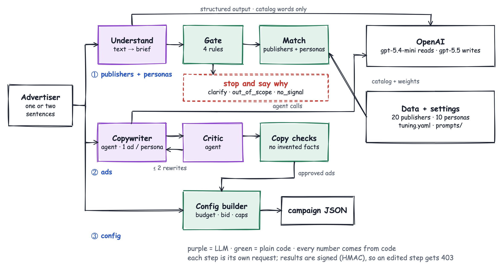

# Placement Studio

Type one or two sentences about a business. You get ranked publishers (with why the rest lost), 3–5 ads written for different shopper personas, and a campaign config where every number is explained. Vague, B2B or empty input gets an honest answer instead of a campaign.

**Live:** https://byash010-placement-studio.hf.space (cold start ≈1 min). The 15 example advertisers run live like any other input: a step takes a few seconds, the ads about 10 s.

**Demo video (24 s):** [watch it](https://byash010-placement-studio.hf.space/demo.mp4)

[](https://byash010-placement-studio.hf.space/demo.mp4)

```
cp .env.example .env          # add OPENAI_API_KEY
docker compose up --build     # API + UI in one command (our npm run dev): http://localhost:8000

uv sync; (cd web && npm install); make dev-api; make dev-web   # local dev, two terminals
uv run pytest -q; (cd web && npx vitest run)                   # tests
```

## How it works



```
① Understand → Gate → Match      publishers + personas      POST /api/campaign
② Copywriter + Critic agents     one ad per persona          POST /api/creatives (+ /regenerate)
③ Config builder (code)          budget, bids, caps, pacing  POST /api/config
```

**Numbers from code, words from the LLM.** The LLM reads the text into a brief, and it can only use the catalog's own category words. A gate then picks one of five outcomes: proceed, weak_fit, clarify, out_of_scope or no_signal. Its confidence is the LLM's own estimate (not a calibrated probability) with thresholds tuned on the train split. Publishers are scored on 4 visible factors and personas on 3. Ads follow a [copywriting playbook](prompts/copywriting_playbook.md), and code checks each one for invented facts, length, generic copy and parroting.

**Agents and steers.** Each step has a "Tell the agent…" box; that note is the *steer* ("skip pet stores", "under $5k"). An agent ([OpenAI Agents SDK](app/stepagents/)) picks which existing functions to call and with what inputs; code still computes every number. Without a steer, ① and ③ are plain code, because agents matched code exactly there. ② always uses agents: a judge preferred their ads 67% of the time ([comparison](evals/AGENT_COMPARISON.md)). Errors, timeouts or the cost cap (≈25–30¢ per session) fall back to code.

**Ads in ~10 s on average.** Personas run in parallel. Code's copy checks run before the Critic, so only clean drafts cost a review, and an accepted draft is the final ad.

**Safe between steps.** Steps are stateless and signed (HMAC), so a tampered request gets a 403. Live calls are rate-limited.

## Campaign config, and why

| Field | Why |
|---|---|
| `objective`, `conversion_event` | Purchase vs subscription_start: what the bidder optimises |
| `budget` | Σ per publisher of min(reach cap, target CPA × 50 conversions), rounded to $500; weak fit = a small test. Your number wins |
| `bid_strategy` | Target CPA = 35% of order value (× 2 for subscriptions) |
| `targeting` | Buyer ages, gender, interests, personas |
| `line_items` | Publisher, budget share by fit (10% floor, reach cap), its ad |
| `frequency_cap` | By price tier: value 5 per 7 days … luxury 2 per 21 |
| `guardrails` | Pause at 1.5× target CPA after 2,000 impressions |
| `rationales` | One line per field |

## Evals

121 labelled cases, split by group into 85 train / 36 held out ([details](evals/README.md)).

- Outcomes: train **85/85**, held out **35/36**, the 15 given examples **15/15**.
- Publishers: must-have hit 96% / 100%, never a must-not.
- Personas (79 labelled cases): right shoppers 90% / 93%; wrong ones avoided 99% / 100%.

## Hard vs easy

Easy: calling an LLM. Hard: knowing when *not* to build a campaign; matching that is stable and explainable; ads that never invent facts; evals that don't fool you.

## What I cut, and why

Image ads, accounts and saved campaigns, auction modelling (a flat $12 CPM caps reach), an ad-policy engine: none changes the core decisions. Tried and dropped (code removed, results kept): a Laya classifier gate (the LLM gate measured better) and a graph matcher (tied the formula; [comparison](evals/GRAPH_COMPARISON.md)). Known limit: most one-liners give no age or gender, so category and price decide the ranking.

## With another week, and at scale

Fresh eval cases; learn weights and gate calibration from real conversions; an ad-policy layer. At scale: an embedding prefilter before scoring 10k publishers, small trained models for the typed decisions, LLMs only for the ambiguous cases.
